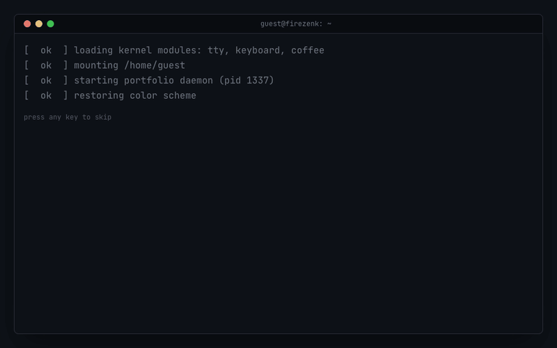
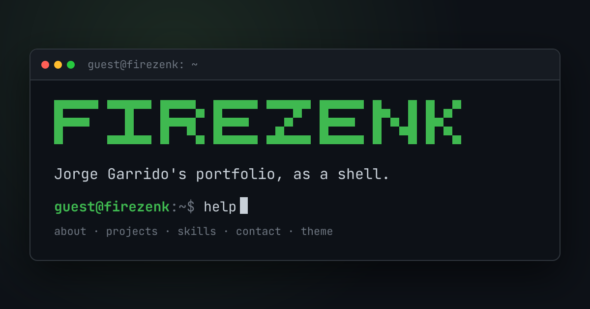

# term-folio

> My portfolio, as a terminal. Type `help` and explore.

An interactive, keyboard-first portfolio that looks and behaves like a shell —
command history, tab completion, themes and all.



## Features

- [x] Terminal shell UI (prompt, input, scrollback)
- [x] Command registry: `help`, `about`, `whoami`, `clear`
- [x] Commands: `projects`, `skills`, `contact` (with clickable links)
- [x] Tab autocomplete and ↑/↓ history navigation
- [x] `theme` command — dracula, matrix, gruvbox, solarized (remembered across visits)
- [x] Boot sequence with ASCII banner and typing effect (any key skips; honors reduced motion)
- [x] Open Graph / Twitter card image generated at build time (`next/og`)
- [ ] Live deployment on Vercel

## Stack

- [Next.js](https://nextjs.org) (App Router) + React + TypeScript
- [Tailwind CSS](https://tailwindcss.com) v4
- JetBrains Mono

## Run locally

```bash
npm install
npm run dev
```

Open http://localhost:3000.

## Deploy

[](https://vercel.com/new/clone?repository-url=https%3A%2F%2Fgithub.com%2FFireZenk%2Fterm-folio)

Zero config: import the repo on Vercel and it builds with `next build`.
Absolute Open Graph URLs use `VERCEL_PROJECT_PRODUCTION_URL`, which Vercel sets
automatically — no environment variables needed.

The social preview lives in [`src/app/opengraph-image.tsx`](src/app/opengraph-image.tsx):



## License

[MIT](LICENSE) © Jorge Garrido
